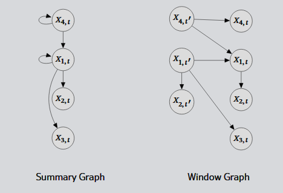

# TSCD Quick-Start Guide
If you're just getting started with Time Series Causal Discovery (TSCD), it can be challenging to figure out where to start. Every project is unique, and your data, your constraints and your research questions will all shape the methods that you might prefer. 

Complimenting the discussion in our [tutorial article](https://arxiv.org/abs/2610.13430), this page is intended as a short guide for new users of TSCD methods. In the main article, we talk at length about the landscape of methods and their underlying assumptions, constraints and philosophies. Here, we provide a TL;DR on TSCD. 

## Q1: Definition of causality
Causal discovery is the problem of learning a causal graph. TSCD is that same  problem posed for specifically time series data. However, different TSCD methods learn different types of causation, so the first step is always to determine which type you need.

| Meaning of arrow X --> Y | Causality type | Explanation |
|---|---|-----|
| The past of X helps predict the future of Y | Predictive causality | Lightning always comes before thunder. Similarly, these kinds of causal graphs represent relationship where one event indicates a related future event. This type does not tell you about treatments/interventions, but it can be very useful for diagnosis or associative studies. |
| Interventions upon X can influence Y | Structural causality | Interventions are controlled changes, such as prescribing a medication or applying an electrical stimulus. If your goal is to control or treat a condition, then this should be your preferred type. |
| The behaviour of Y is synchronized with changes in X | Dynamical coupling | Some systems exhibit deterministic patterns over time. This causality type detects if these patterns are synchronized across signals. Although less common, this style of analysis is typically applied to systems with so-called dynamical attractors. |

## Q2: What kind of graph do you need?
Depending on what paper you're reading, you may see slightly different types of causal graphs. For TSCD, there are two common cases to be aware of:
- **Summary graph:**  This type describes the causation X-->Y without any information the duration, lag or delay between causal events. It tells you that causation occurs, but does not specify the time delay of causal influence. 
    - For N signals, a summary graph will always have N nodes. 
- **Window graph:**  This type makes timing explicit. Nodes in this graph are not just signals, but also have a time delay. For example, X_(t-2) --> Y_t has a lag of 2. 
    - For N signals, a window graph will have N x (Q+1) nodes, where Q is the maximum past lag to be considered. Q=1 corresponds to the case where all nodes are fixed at time t or time t-1. 

In short, summary graphs discard timing information to make a simpler image. Window graphs include timing information to yield more detail.

## Other Considerations
Once you have answered the first two questions, you are already very close to selecting a method. There are a few other considerations that might lead you to specialist solutions. 

1. **Are important variables unobserved?** If you can reasonably assume causal sufficiency, start simple. If hidden common causes are a serious concern, use a method designed for latent confounding rather than pretending the issue does not exist.
2. **What do your signals look like?** If you can assume linear dynamics, then there may be fast and efficient methods for your purposes.
3. **How much history should the model see?** You typically measure this with respect to the sampling rate. 
    - Example: A 1kHz sampling rate corresponds to a 1ms sampling period (time between observations). If I anticipate that causal influences might take between 2 to 8 ms to propgate between signals, then I need up to 8 past lags to detect all causal relationships.
    - The window length is typically controlled by a parameter. Choosing a window that is too short can miss slow effects; choosing one that is too long can reduce statistical power
4. **How do I know if it worked?** Often your first step should be to evaluate your method on a data set or simulation where you know (or assume) the ground truth. Use metrics like precision/recall/F1 or SHD to measure accruacy. 
    - If you have multiple candidate models, you can also use these metrics to compare them.

## Where should I start?
With all of the above points in mind, we can consider a few baselines. Note that the below recommendations might not be optimal; there are many extensions of these methods, and maybe more specialized methods exist for your problem. However, if you're a newbie and need a starting point, we can point to the following:

- **Predictive causality + summary graph:** try **linear Granger causality**.
    - For nonlinear relationships:** consider **transfer entropy** or a **nonlinear Granger causality** method.
- **Structural causality + window graph:** try **PCMCI**.
    - If there is also possible latent confounding:** consider **LPCMCI**.
- **Structural causality + linear, non-Gaussian dynamics:** consider **VARLiNGAM**.
- **Dynamical coupling + summary graph:** try **CCM**.

